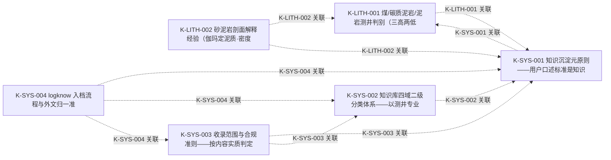

# 知识图谱总览

> **元原则（K-SYS-001）**：口述标准=知识源，可能片面/不对/区域性；
> 经井数据验证校正后沉淀为条目（version 递增、校正历史留痕、status 标注），
> 形成真正的知识加入知识库并形成本图谱。校正流程见 kb_graph.py 文档头。

## 条目清单

| ID | 标题 | 类型 | 适用范围 | 状态 | 版本 | 日期 | 来源 | 修正自 | 关联 |
| --- | --- | --- | --- | --- | --- | --- | --- | --- | --- |
| K-LITH-001 | 煤/碳质泥岩/泥岩测井判别（三高两低·尖峰状·伽玛低值） | 判别知识 | 砂泥岩剖面（区域性——阈值经验值随井校正；区域有/无由 info.json「区域知识」约束） | 试行 | v1 | 2026-10-28 | 用户口述（XIMENIA-5 / BET-1 复核反馈，2026-10-27~1 | — | K-SYS-001 |
| K-LITH-002 | 砂泥岩剖面解释经验（伽玛定泥质·密度对照井径·同砂体并层） | 解释经验 | 砂泥岩剖面（区域无关，全井通用；密度门控需本井 CAL 与钻头尺寸） | 试行 | v1 | 2026-11-06 | 用户口述（XIMENIA-5 综合图审阅，2026-11-06） | — | K-LITH-001、K-SYS-001 |
| K-SYS-001 | 知识沉淀元原则——用户口述标准是知识源，须经校正升级为知识库知识 | 元原则 | 全局 | 已验证 | v1 | 2026-10-28 | 用户定调（"我给你的要求定的标准其实就是知识，有时片面、有时不对、有时区域性，需 | — | K-LITH-001 |
| K-SYS-002 | 知识库四域二级分类体系——以测井专业为主的油气知识库 | 元原则 | 全局 | 已验证 | v2 | 2026-11-12 | 用户定调（测井方法按技术大类×厂商小类；解释方法单列第6大类；地质/通用按大类× | — | K-SYS-001 |
| K-SYS-003 | 收录范围与合规准则——按内容实质判定，测井类服务合同及特定国家财税要求可入档，排除行政个人隐私等敏感内容 | 体系规则 | 全局 | 已验证 | v2 | 2026-11-13 | 用户定调（"以测井专业知识为主的油气知识库，注意合规不包括行政个人隐私信息等敏感 | — | K-SYS-001、K-SYS-002 |
| K-SYS-004 | logknow 入档流程与外文归一准则——bootstrap_knowledge.py 为正本，全文与图谱双写，外文识别成中文入库不重复 | 体系规则 | 全局 | 已验证 | v1 | 2026-11-13 | 用户定调（"用logknow来入档，也就是其目录下的bootstrap_know | — | K-SYS-001、K-SYS-002、K-SYS-003 |

## 关系图

## 状态图例

- **试行**：已落判据，阈值/口径仍可能随新井复核校正
- **已验证**：双井回归通过且经多井复核无反例
- **已修正**：曾被修正（当前内容为最新版，旧结论在校正历史）
- **已废止**：被证伪或被新条目替代（留痕不删除）
